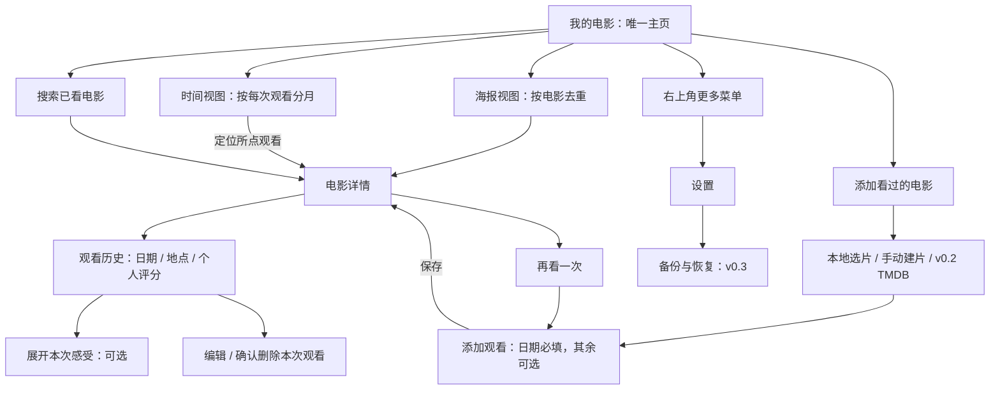

# 历史设计：v0.1–v0.3

本文件归档旧版设计约定，当前产品以 [现行设计](../../design-review.md) 为准。旧截图和备份早期草案仅为历史，不代表 v0.4 行为或协议。

# 产品与设计约定

2026-10-23 确认的第二稿：Seen 是个人的已看电影库，以电影为主页主体；感受属于某次观看的可选内容。单一主页，无底部导航；0.5–5 星、半星步进、允许未评分。主要设备为 Redmi K70 Ultra / Android 16，v0.1 先用 API 36 模拟器验收。

本页保留现行产品、交互与视觉约定，取代原始 brief 和第一稿。设计目标不等于已实现或已通过设备验收；功能分版见 [开发规划](../../roadmap.md)，实际证据见 [验证日志](../../v0.1.0-validation.md)。

[六屏 UI 示意（PNG）](../../ui-review.png) / [SVG 源文件](../../ui-review.svg) · [主页](../../ui-home-v2.png) · [电影详情](../../ui-movie-detail-v2.png) 包含后续版本能力；示意海报为矢量构图，不是实际电影数据。

## 产品与数据原则

- 个人、单设备、本地优先，无账号、广告、遥测、后端或云同步。
- Movie 是浏览对象，Viewing 是独立的一次观看；只填片名和观看日期即可保存。
- 海报视图每部电影一项；时间视图每次观看一项；感受只在详情展示。
- 同一电影允许重复观看；删除一条观看不影响其他历史。最后一条删除后，主页隐藏电影，保留 Movie 供复用。
- 观看日期采用 LocalDate，时间可空，不转 UTC；创建和更新时间采用 UTC Instant。
- 保存新电影与首条观看使用事务；稳定 ID 防保存重试重复。数据库结构变化必须提供迁移，禁止清库升级。
- 海报复制到私有文件，数据库保存相对 key，不依赖外部 URI 或临时缓存长期有效。
- 系统备份与设备提取已配置为禁用，厂商行为仍须真机核验；不以真实记录实例进行卸载、清数据实验。

## 信息架构与交互流程



**顶部操作：**标题行左侧 Seen，右侧搜索、添加、更多三个 48dp 触控区；更多菜单含“设置”“关于”。二级页面返回上级，不出现底部导航。顶部添加是全局新增；电影详情中的“再看一次”直接复用当前电影。

**两个视图的语义：**海报视图一部电影一项；时间视图一次观看一项，同一电影可因重看出现多次。切换时显示“4 部电影”或“6 次观看”，避免混淆。视图选择保存在本地；默认首次打开为海报视图。时间视图点击电影进入详情并定位对应观看。主页搜索只查本地；添加流程中的 TMDB 搜索负责找新电影，不混合两类结果。

保存成功进入电影详情并定位刚保存的一次观看；返回主页保留视图、筛选和滚动位置。编辑保存返回原详情；删除后留在电影详情并更新历史，若已无观看，页面显示“暂无观看记录”，返回主页时该电影消失。保留本地 Movie 供之后复用。

新增 Movie 与第一条 Viewing 事务创建；未保存退出不遗留空电影。保存防连击；失败保留输入；旋转保留状态，长文本草稿在私有存储中短暂保留，保存或明确放弃后清理。

## 页面设计

本稿六屏依次为：电影主页（海报）、电影详情、添加观看、主页时间视图、添加电影、设置。界面为目标状态，含 v0.2/v0.3 能力，不代表已实现 App。海报采用原生矢量构图示意，**并非原版海报**；最终产品使用用户选择或 TMDB 提供的真实电影海报。背景文字不叠在真实海报上。

### 我的电影 · 默认海报视图

- 顶部品牌 Seen 26sp，不再出现“日记”标题、手记定位语或抒情引导文案。
- 下一行显示“我的电影”和电影数量；一侧轻量“海报 / 时间”视图选择。不是底部栏目，也不分别建两个电影库。
- 390dp 页面左右 20dp，列间距 16dp，两列电影卡，每幅海报约 167 × 251dp。比第一稿更大，更容易辨认。
- 海报下方片名 16sp，中等字重，最多两行；下一行年份 12sp、个人星级/数值 12sp；重看可额外显示“2 次观看”。评分取最近一次观看的评分，不向更早的记录回退、不算平均；空评分不展示星星。
- 不显示感受、地点、长日期，不加独立“最近一部”巨型横幅；影片按最近观看日期排序。内容直接形成电影库，避免首页变成杂志日记或推荐页。
- 顶部加号的无障碍名称为“添加看过的电影”。无额外悬浮“记一笔”按钮，不遮挡海报。
- 默认排序为最近观看日期倒序，同日按最后创建的观看、电影 ID 稳定排序；排序菜单可选片名/上映年份。空状态“还没有电影 / 添加一部看过的电影。”，唯一主按钮“添加电影”。

### 电影详情 · 统一内容中心

- 顶栏返回与更多操作；下方主区约 136 × 204dp 海报，右侧片名 24sp、原名 13sp、年份，v0.2 补导演/片长等少量资料；不放社区评分和推荐内容。
- 主区下方显示“看过 2 次”，可在足够空间时展示最近一次日期；日期 13–14sp，不再做放大日数。
- 一个主动作“再看一次”，进入轻量观看编辑器；有历史时不重复出现多个新增按钮。
- 下方“观看记录”按日期倒序，每条先展示日期、地点、个人评分；个人评分标明所属观看，避免和电影资料混淆。
- 某次观看的感受位于该记录内部，点击“感受”展开，或点记录展开详情；从时间视图进入时自动展开对应记录。正文完整显示、可选择复制。没有感受时不显示空卡片或催写文案，只有记录菜单内的“添加感受”操作。
- 观影记录的编辑/删除在各条记录菜单；不再建立独立“手记详情”一级浏览体验。展开区域同时承载完整地点/时间/感受，避免主页→记录→电影的往返跳转。
- 若删除最后一条 Viewing，仅 Movie 留存；当前位置可再次记录，主页隐藏该电影。删除弹窗明确“仅删除这次观看记录”。

### 添加 / 编辑观看

- 标题“添加观看”或“编辑观看”，顶部保留片名与小海报，避免离开电影语境；不使用“写一笔”。
- 第一部分仅观看日期（默认今天）与可选个人评分；第二部分“更多信息”可展开时间、地点；第三部分“添加感受（可选）”按需展开多行输入。
- 不默认出现大文本框，填完日期即可保存。进入编辑已有感受时自动展开；未填感受也不提示内容不完整。
- 日期用 Android 日期选择器，补记允许过去日期，未来日期在新增/编辑时提示；时间可清除，不以 00:00 代替未知时间。
- 评分候选 0.5–5 星；星形仅显示，加减各占 48dp，清除恢复 null。未评分和最低分不同。
- 退出有修改时“继续编辑 / 放弃修改”；保存失败保持字段。地点建议最多 200 码点、感受 50,000 码点；emoji 不在中间截断。表单展开和键盘打开时整页可滚动，保存始终可达。

### 我的电影 · 时间视图

- 顶部与海报视图相同，仅切换展示方式；年月为 18sp 组头，次级显示本月观看次数。
- 每次观看一行：约 72 × 108dp 海报，右侧片名 17sp、年份、观看日期 13sp、个人评分；地点和感受不在主页展示。重看用“第 2 次观看”等轻量说明。
- 不再设置左侧大日数，不采用日记纵线和大段摘录。片名和海报仍是第一眼信息。
- 按观看日期倒序；同日有时间的记录按时间倒序，再列未填时间；完全相同则用创建时间和 ID 稳定排序。未知时间不显示 00:00。

### 添加电影 / 本地搜索

- 主页搜索标题为“搜索我的电影”，搜索本地标题与原名；结果以电影为单位，点击直接进入电影详情。感受全文搜索不是当前需求，暂不放大范围。
- 顶部加号进入“添加电影”，v0.1 可选择已存电影或手动建片；v0.2 主搜索框明确“搜索电影名称”，查询 TMDB，已收录结果显示“已看过 · 可再次记录”。
- TMDB 结果展示海报、片名、原名、年份；约 350ms 防抖，取消过期请求，选中后才保存。相同 TMDB ID 复用；同名同年手动项不自动合并。
- 找不到或无网时始终有“手动添加”。手动片名必填，年份/原名/海报可选；海报经系统图片选择器选取后复制到私有存储，不依赖外部 URI 长期有效。
- 加载、无结果、无网络、缺凭据分别显示；不把请求失败说成电影不存在。

### 设置 · 次级工具页面

- 从主页更多菜单进入，不占常驻导航；返回回到原电影视图与位置。
- 保留数据备份/恢复、外观说明、版本与来源署名。v0.1 只出现已有能力，v0.3 再加备份恢复；不放未实现的灰色功能清单。
- 关于区保留品牌定位语与 TMDB 署名。浅色先行，不展示无效主题开关。
- 导出与恢复仍用系统文件选择器，恢复先预检再明确确认覆盖，详见后文。

## UI 设计系统

### 视觉方向

界面退后，电影海报提供主要色彩。中性近白背景、深色主按钮、清晰片名字重、紧凑辅助信息；取消第一稿的绿色主题、大日期和手记摘录。避免大面积磨砂、渐变背景与漂浮卡片。海报本身保持 2:3，不为统一颜色给真实海报加滤镜。

| Token | 值 | 用途 |
| --- | --- | --- |
| background | `#F7F7F5` | 中性近白底 |
| surface | `#FFFFFF` | 编辑区域、弹窗、选中视图 |
| textPrimary / primary | `#202124` | 标题、正文、主要操作 |
| textSecondary | `#64676C` | 年份、日期等辅助信息 |
| onPrimary | `#FFFFFF` | 深色按钮文字 |
| divider | `#DFE0DE` | 装饰分隔，不作为唯一边界 |
| controlBorder | `#7B7E83` | 必要输入框边界 |
| danger | `#A63732` | 删除、字段错误，同时用文字说明 |
| posterPlaceholder | `#E5E6E3` | 真实缺图时的中性占位 |

系统中英文字体，避免印刷体装饰。Seen 品牌 26/32sp、电影详情标题 24/32sp、主页小标题 20/28sp、海报片名 16/24sp、时间视图片名 17/25sp、正文 16/26sp、辅助信息 12–14/18–22sp。字重标题 500–600，正文 400。评分与标题使用深墨色，不把所有评分染成醒目金色。

静态检查：主文字/背景 15.01:1，辅助文字/背景 5.29:1，白字/主按钮 16.10:1，控件边框/白底 4.07:1；已检查文档本地链接、JSON 示例和 SVG 语法。以上为设计稿静态检查；当前实际构建、设备与字号检查结果见 [验证日志](../../v0.1.0-validation.md)。

间距采用 4dp 倍数，以 8/12/16/20/24/32dp 为主。390dp 横边距 20dp，海报间距 16dp；海报圆角 8dp，无重阴影；按钮圆角 12dp、高至少 48dp；控件边界需可识别。按下用轻微遮罩，转场 150–220ms，遵守系统动画设置。

### 组件与状态

| 组件 | 规范 |
| --- | --- |
| 顶部操作 | 搜索/加号/更多图形约 22–24dp，各 48dp 触控区；保留明确读屏名称 |
| 海报卡 | 整卡可点，标题最多两行；年月/评分次级；不可把操作按钮叠到海报正文 |
| 视图切换 | 海报/时间为同一电影库的两种视图；选中有底形/字重变化，不只变色 |
| 缺图 | 稳定的 2:3 灰色占位、片名仍可读；不把示意海报作为实际用户数据 |
| 观看记录 | 日期、地点、评分正常字号，感受按需展开；菜单操作作用域是本次观看 |
| 编辑器 | 日期与评分优先，可选感受折叠；错误就近说明，不丢输入 |
| 空/加载/错误 | 内容空时给相关添加动作；网络故障保留手动入口；无多余抒情说明 |

无障碍验收继续覆盖 200% 字号、TalkBack、键盘与手势区。390dp 两列；极窄窗口或大字号按内容需要退为一列/海报列表，宽屏按最小可用卡宽增加列数；不固定卡片文字高度。读屏按“片名、年份、最近一次评分、观看次数”组合播报，重复海报描述隐藏。静态稿只表示常规字号目标布局，不代表设备验收通过。

## 后续设计草案：JSON 备份（v0.3，未实现）

2026-10-24：v0.3 开发规格已收敛为 [备份协议与恢复方案](../../backup-format.md)，以该文档为实现依据；下列早期示例保留作设计历史。其中导演/国家数组、偏好和远端海报字段不进入首版协议。

文件建议名 `seen-backup-2026-10-23.json`，UTF-8。`schemaVersion` 指备份协议，不等于 Room 数据库版本。UUID 跨恢复保持稳定。以下为结构示例，完整性规则在示例后列出。

```json
{
  "schemaVersion": 1,
  "appVersion": "0.3.0",
  "exportedAt": "2026-10-23T06:00:00Z",
  "movies": [{
    "id": "3d111111-1111-4111-8111-111111111111",
    "tmdbId": null,
    "title": "完美的日子",
    "originalTitle": "Perfect Days",
    "releaseDate": null,
    "releaseYear": 2023,
    "directorNames": [],
    "runtimeMinutes": null,
    "productionCountries": [],
    "posterRemotePath": null,
    "posterAssetId": null,
    "source": "MANUAL",
    "createdAt": "2026-10-23T05:00:00Z",
    "updatedAt": "2026-10-23T05:00:00Z"
  }],
  "viewings": [{
    "id": "7a222222-2222-4222-8222-222222222222",
    "movieId": "3d111111-1111-4111-8111-111111111111",
    "viewedDate": "2026-10-22",
    "viewedTime": null,
    "location": "家里",
    "ratingHalfStars": 9,
    "notes": "平凡的日子，也值得认真记住。",
    "createdAt": "2026-10-23T05:00:00Z",
    "updatedAt": "2026-10-23T05:00:00Z"
  }],
  "assets": [],
  "preferences": { "theme": "LIGHT" }
}
```

有海报时 `assets` 含 `id`、`mimeType`、`sha256`、`base64`；Movie.posterAssetId 指向相应项。只打包应用已保存的海报，导出不联网补全；缺图显示数量提示。无机器绝对路径，无凭据、签名信息或临时草稿。导出包含所有 Movie（包括已无 Viewing 的条目），防止静默丢失资料。

建议首版限制：输入文件最大 100MiB、电影最多 10,000、观看最多 100,000、单张海报解码后最大 2MiB、最长边 2,048px。导出采用同等限制，预检超限则不生成声称可恢复的备份，提示缩减媒体或等待分卷能力；不悄悄丢弃记录。限制是实现建议，首次真实备份验收后可调整。

恢复策略仅“覆盖恢复”，暂不做合并：

1. 系统选文件到私有暂存区，边读边限制大小；取消/权限错误不改库。
2. 校验 JSON、支持的 schemaVersion、必填类型、UUID 唯一性、TMDB ID 唯一性、日期/时间、评分、字符长度、Movie 引用和海报引用/哈希/MIME/尺寸。未知高版本拒绝；支持的旧版先转换成当前 DTO；可忽略的未知字段不影响读取。历史记录的未来日期仅提示时钟可能不一致，不因换机当天设置错误拒绝旧数据。
3. 展示“将用文件中的 X 部电影 / Y 次观看替换当前 A 部 / B 次观看”，明确覆盖；提供先导出现有数据的动作。用户取消预览不改变任何数据。
4. 海报先写入新的不可变文件 key；不删除正在使用的文件。最终确认后短时暂停写入，Room 单事务替换 Movie/Viewing；事务失败回滚原库，清理未引用新文件。
5. 数据事务成功后更新非关键偏好；失败可保留原偏好并说明，不能把已提交数据误报为未恢复。旧媒体延后按引用清理。中途进程退出不会让原库指向未准备好的媒体。
6. 成功刷新页面；失败保留原数据并说明原因。测试包含 SQL 写入失败、损坏海报、磁盘不足、文件读取中断及恢复时进程终止。

导出先在私有暂存文件中生成并校验，再复制到用户选择的位置；系统文档提供器可能在写入中断时留下不完整文件，必须报告失败并尽力删除，不能声称跨所有提供器原子写入。导出成功以完整写入并关闭成功为准。备份为明文，文件选择页简要提醒其包含个人感受，由用户选择保存位置。
