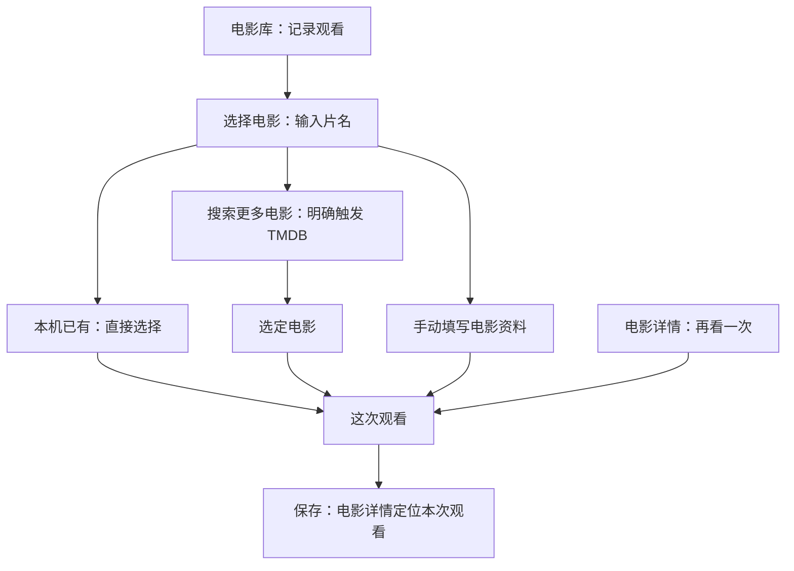

# v0.4.0 第二稿：先调整页面职责与记录流程

**历史讨论稿。** 用户随后明确恢复底栏、取消时间视图、收紧左上标题，最新设计以 [第三稿：底部入口与海报电影库](../../../v0.4.0-navigation-design.md) 为准。下文无底栏与双视图内容不再是实施目标。

2026-10-25，待评审。用户反馈第一稿过于像苹果、观感廉价，当前优先级改为页面布局与业务操作流程。本稿取代第一稿的布局和实施顺序；第一稿静态图保留作历史，不再作为推荐目标。当前仅方案，不修改 Android 代码。

## 问题判断

“廉价”是用户的视觉评价，不能归因为某一种颜色。我的设计判断是：第一稿套用了大标题、蓝色动作和灰底圆角组，但内容的组织方式几乎没变；多处用空白替代层级，又用同样的几何海报占位，容易呈现通用控件拼装感。下一稿先解决页面职责、密度和阅读顺序，再决定视觉。

检查当前代码后，可以确认以下具体问题：

| 位置 | 当前行为 | 调整方向 |
| --- | --- | --- |
| 主页 | Seen 顶栏、我的电影/数量、视图/排序分成三排 | 页名与工具一排，展示控制一排，电影尽早进入视口 |
| 添加电影 | 手动添加与 TMDB 按钮先出现；本地匹配放在远端结果之后；空查询时列出全部本地电影 | 先找已有电影，按需查线上，手动入口始终可达但降低视觉权重 |
| 编辑器 | 新建电影资料与一次观看共用长表单；即使评分/日期很少也有多段分割和折叠 | 将“选定哪部电影”与“这次怎么看”分成连续两步 |
| 电影详情 | 资料在海报右侧逐项纵排，主按钮与资料占去较多首屏空间 | 电影识别信息紧凑，个人观看记录尽早出现 |
| 保存导航 | `onSaved` 收到 movieId 后丢弃 viewingId；保存后没有指定记录焦点 | 新增/编辑成功定位本次记录；避免重看旧日期时保存结果埋在历史里 |
| 设置 | 备份说明、凭据表单、署名与关于全部纵向展开 | 按任务进入工具页，入口只显示必要状态 |

上表前三项与详情的影响属于基于实现的 UX 判断，不是已完成用户测试。`SeenApp.kt` 的保存回调忽略 viewingId 则是可直接核对的实现行为。

## 三条主任务

1. 回顾看过的电影：电影库 → 电影详情 → 观看记录。
2. 记一次观看：记录观看 → 选电影 → 填日期/可选评分 → 保存并看到本次记录。
3. 重看一部电影：电影详情 → 再看一次 → 填本次观看 → 回到该电影并定位新记录。

备份与凭据是低频工具，不占电影库首屏。电影和观看继续分别存储，电影库按电影去重，时间视图按观看显示。评分继续属于具体观看，不引入新的“电影总评分”或自动平均。

## 主页：一个身份，两层内容

```text
我的电影                    搜索  ＋  更多
海报  时间        36 部电影       排序

[海报]                 [海报]
片名                   片名
年份  最近评分         年份  最近评分
```

不同时堆叠 Seen 品牌与我的电影两个标题。Seen 可以保留在应用图标、启动与关于中；主页直接表达内容。添加图标的读屏名称明确“记录一次观看”。默认仍为海报视图，不加底部导航或新的首页。

数量属于当前视图，放在控制行的次要位置；进入搜索时让搜索框替代标题内容区，而不是再加一排。搜索电影库不触发网络。时间视图保留同一页面骨架，月份是内容分组，观看日期与个人评分是每行辅助信息。

海报卡只含海报、片名和一行必要资料；重看次数仅在有重看时出现。390dp 先比较两列与三列真实内容密度，两列作为默认候选，不为了显得简约把海报一味放大。首轮布局评审要同时看短片名、长中文片名、缺海报和几十部电影，不能只看四张理想占位图。

有草稿时，用一行带片名的“继续编辑《…》”入口；点击全局添加若存在草稿，先提供“继续编辑 / 放弃后新建 / 取消”，不能覆盖原输入。该分支属于拟议的交互调整，实施前应核对 ViewModel 现有草稿保护并复用。

## 添加流程：先电影，再观看

页面标题使用“记录观看”，让入口表达用户任务；第一步组头“选择电影”，第二步“这次观看”。不是管理一个可脱离观看的新电影目录。



输入后立即展示本地匹配，远端查询通过搜索键或“搜索更多电影”明确提交。用户不必理解 TMDB 才知道如何添加；来源署名继续保留。空查询不铺满全部本地电影，可展示少量最近电影，完整本地库已经有主页。

手动添加作为持续可达的次要文字动作。无凭据、断网、无结果均不阻断手动路径。选择远端条目如已有相同 TMDB ID，沿用事务内复用 Movie 的规则；同名手动电影不自动合并。

手动资料第一步只强调片名；年份、原名与海报作为可选资料。点击下一步只更新草稿，不落库；在第二步返回第一步保留所有输入，不创建空电影。新增 Movie 与首条 Viewing 仍在最终保存事务中创建。第一步取消/返回的草稿与退出确认需纳入状态设计，不能仅画两张表单而漏掉导航行为。

## 观看编辑：短表单完整呈现

```text
返回              这次观看              保存

小海报   完美的日子
         2023

观看日期                         今天 ›
个人评分                       未评分
                  减半星  星级  加半星

添加时间      添加地点      添加感受
```

日期与评分直接可见。可选字段使用明确入口，点击后就在原位置展开，保留标签与错误信息。日期默认今天，时间依然允许未知；选择评分后出现清除动作。已有字段在编辑时展开，录入后不能因折叠丢失。

保持全页编辑，便于长感受、键盘、旋转与草稿处理；本次不增加另一套弹层编辑。保存时显示忙碌、抑制连击，失败保持输入。退出和返回上一步有不同语义，必须分别测试。

新建、重看、编辑分别使用“记录观看”“再看一次”“编辑观看”上下文，不把所有动作都叫添加电影。保存后回到电影详情并定位/展开本次观看，保留主页原视图、查询与滚动位置。

## 电影详情：从资料页变成个人观影页

```text
返回                                     更多

[海报]   完美的日子
         Perfect Days
         2023 / 124 分钟
         导演：维姆·文德斯
         更多资料

观看记录  2 次                      再看一次

10 月 24 日                         个人评分 4.5
家里 / 20:30                              更多
感受正文开头……                         展开
────────────────────────────────────────
10 月 3 日                              未评分
电影院                                    更多
```

资料负责确认电影身份，观看记录是页面主体。“再看一次”放在记录区标题旁，保持至少 48dp 可点区域；窄屏或大字号另起一行，不压缩标题与次数。这样减少资料下方横贯全屏的按钮所占空间，同时保持记录操作就近。

较长的国家与其他资料按需展开，TMDB 来源入口在资料区可找到。个人评分与原名/上映年份分区，不能看起来像影片的公共评分。记录无感受时自然收紧；有感受时建议直接显示最多三行摘录，展开后完整可复制。摘录只出现在详情，主页仍不显示感受。

从时间视图或保存返回的目标记录自动定位并展开。重看次数多时，记录列表继续懒加载；不在本版新增全文搜索、复杂筛选或另一层记录详情页面。

## 设置与视觉取向

设置首屏仅保留“备份与恢复”“电影资料连接”“关于”三个清晰入口及必要状态。无账号，不放个人头像或“我的”栏目；恢复危险说明在对应流程完整显示。

下一版视觉稿先用真实长度的合成文本和明确标注的不同示例海报比较布局。控制中性、紧凑而不过密；不用苹果蓝、大标题、灰底圆角组作为统一模板。颜色、圆角与深色主题随后评审，深色不再排在信息架构之前。

## 评审和实施顺序

1. 先评审主页、选择电影、观看编辑、详情四页的低保真布局与完整返回/保存分支。
2. 用相同内容比较首屏能看见什么、常用动作是否明确、操作后是否看见结果，再定字体、颜色、间距和海报密度。
3. 实现时先处理导航和草稿状态，再做布局与视觉，最后回归设置工具页。
4. 涉及流程和业务行为，必须补充有意义的 JVM/设备验证；尤其覆盖手动两步取消不残留电影、重看复用、同名不合并、保存定位、失败输入、草稿冲突和返回状态。

保持现有架构与数据模型，备份协议不变。本稿没有承诺新增数据编辑、合并电影、推荐、统计或播放能力。原有版本交付门槛不变。本轮只检查文档链接与差异，不将第一稿构建结果记成本稿的新验证，也不将低保真结构称为用户已接受。
